# Poly Haven: Industrial & Infrastructure models

**23 assets from [Poly Haven](https://polyhaven.com), dedicated to the public domain under [CC0](https://polyhaven.com/license).** Use them in any game, free or paid, and change them however you like; no credit is needed.

3D models as glTF at 1K and 2K texture resolution, each folder self-contained (`.gltf`, `.bin`, `textures/`). 332.8 MB in all.

This is a copy kept by [zuujis-cc0](https://github.com/zuujis-cc0) so game makers can take single files from GitHub. It is not made by or affiliated with Poly Haven: the originals, often in more formats and higher resolutions, are on [polyhaven.com](https://polyhaven.com). If they help you, consider [supporting Poly Haven](https://www.patreon.com/polyhaven/overview).

Every file is listed in [MANIFEST.tsv](MANIFEST.tsv) with its size and SHA-256. More free assets: [the Zuujis collection](https://github.com/zuujis-cc0/free-game-assets#readme).

| | | | |
| :-: | :-: | :-: | :-: |
|  <b><a href="WetFloorSign_01">Wet Floor Sign 01</a></b> by Fran Calvente · <a href="https://polyhaven.com/a/WetFloorSign_01">source</a> | <a href="concrete_road_barrier">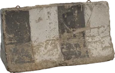</a> <b><a href="concrete_road_barrier">Concrete Road Barrier</a></b> by Amal Kumar · <a href="https://polyhaven.com/a/concrete_road_barrier">source</a> | <a href="concrete_road_barrier_02">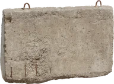</a> <b><a href="concrete_road_barrier_02">Concrete Road Barrier 02</a></b> by Amal Kumar · <a href="https://polyhaven.com/a/concrete_road_barrier_02">source</a> | <a href="exterior_aircon_unit">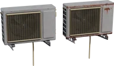</a> <b><a href="exterior_aircon_unit">Exterior Aircon Unit</a></b> by Monsta3D · <a href="https://polyhaven.com/a/exterior_aircon_unit">source</a> |
|  <b><a href="fire_alarm">Fire Alarm</a></b> by Slinc · <a href="https://polyhaven.com/a/fire_alarm">source</a> | <a href="fire_hydrant">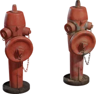</a> <b><a href="fire_hydrant">Fire Hydrant</a></b> by Gonçalo Felício · <a href="https://polyhaven.com/a/fire_hydrant">source</a> |  <b><a href="korean_fire_extinguisher_01">Korean Fire Extinguisher 01</a></b> by UM JOORIN · <a href="https://polyhaven.com/a/korean_fire_extinguisher_01">source</a> | <a href="modular_airduct_circular_01">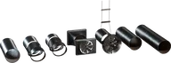</a> <b><a href="modular_airduct_circular_01">Modular Airduct Circular 01</a></b> by Riley Queen · <a href="https://polyhaven.com/a/modular_airduct_circular_01">source</a> |
| <a href="modular_airduct_rectangular_01">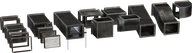</a> <b><a href="modular_airduct_rectangular_01">Modular Airduct Rectangular 01</a></b> by James Ray Cock · <a href="https://polyhaven.com/a/modular_airduct_rectangular_01">source</a> | <a href="modular_electric_cables">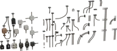</a> <b><a href="modular_electric_cables">Modular Electric Cables</a></b> by Kuutti Siitonen · <a href="https://polyhaven.com/a/modular_electric_cables">source</a> |  <b><a href="modular_electricity_poles">Modular Electricity Poles</a></b> by James Ray Cock · <a href="https://polyhaven.com/a/modular_electricity_poles">source</a> | <a href="modular_industrial_pipes_01">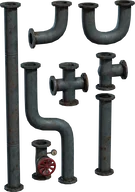</a> <b><a href="modular_industrial_pipes_01">Modular Industrial Pipes 01</a></b> by Jorge Camacho · <a href="https://polyhaven.com/a/modular_industrial_pipes_01">source</a> |
| <a href="modular_metal_gutter">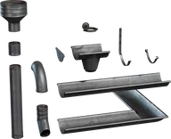</a> <b><a href="modular_metal_gutter">Modular Metal Gutter</a></b> by Maxim Domnin · <a href="https://polyhaven.com/a/modular_metal_gutter">source</a> | <a href="modular_pipes">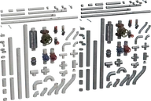</a> <b><a href="modular_pipes">Modular Pipes</a></b> by Kuutti Siitonen · <a href="https://polyhaven.com/a/modular_pipes">source</a> | <a href="modular_pipes_plastic_01">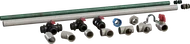</a> <b><a href="modular_pipes_plastic_01">Modular Pipes Plastic 01</a></b> by Amal Kumar · <a href="https://polyhaven.com/a/modular_pipes_plastic_01">source</a> | <a href="overhead_crane">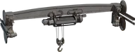</a> <b><a href="overhead_crane">Overhead Crane</a></b> by Timothy3D · <a href="https://polyhaven.com/a/overhead_crane">source</a> |
| <a href="portable_generator">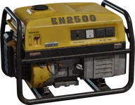</a> <b><a href="portable_generator">Portable Generator</a></b> by James Ray Cock · <a href="https://polyhaven.com/a/portable_generator">source</a> | <a href="power_box_01">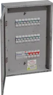</a> <b><a href="power_box_01">Power Box 01</a></b> by Rico Cilliers, Yann Kervran · <a href="https://polyhaven.com/a/power_box_01">source</a> | <a href="security_camera_01">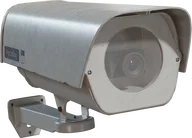</a> <b><a href="security_camera_01">Security Camera 01</a></b> by Alexander Otterbeck, Yann Kervran · <a href="https://polyhaven.com/a/security_camera_01">source</a> | <a href="security_camera_02">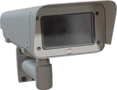</a> <b><a href="security_camera_02">Security Camera 02</a></b> by Garrison Gager, Yann Kervran · <a href="https://polyhaven.com/a/security_camera_02">source</a> |
| <a href="utility_box_01">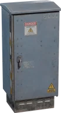</a> <b><a href="utility_box_01">Utility Box 01</a></b> by James Ray Cock · <a href="https://polyhaven.com/a/utility_box_01">source</a> | <a href="utility_box_02">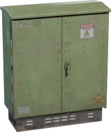</a> <b><a href="utility_box_02">Utility Box 02</a></b> by James Ray Cock · <a href="https://polyhaven.com/a/utility_box_02">source</a> |  <b><a href="water_manhole_cover">Water Manhole Cover</a></b> by Raunox · <a href="https://polyhaven.com/a/water_manhole_cover">source</a> |  |

---

Kept up to date by this repository's own [update workflow](.github/workflows/update.yml), with code and plan from [cc0-mirror](https://github.com/zuujis-cc0/cc0-mirror). Something wrong? [Open an issue there](https://github.com/zuujis-cc0/cc0-mirror/issues/new) or use the [private report form](https://games.zuujis.com/report).
